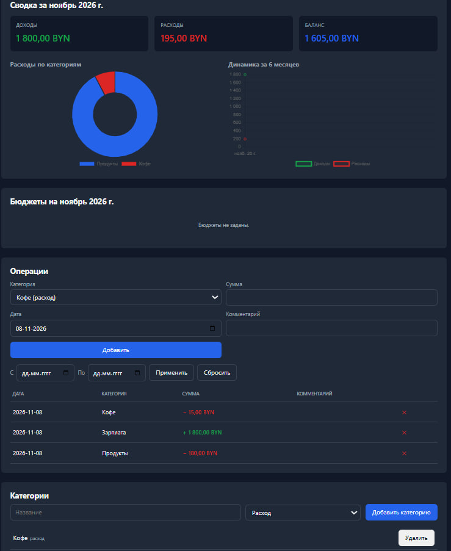

# Финансовый учёт

Веб-приложение для личного учёта доходов и расходов: категории, операции, месячные бюджеты с предупреждением о превышении, сводные отчёты и графики.

[Демо](https://finansovyi-treker.onrender.com/) · [Репозиторий](https://github.com/artur-soul/finance-tracker)



## Возможности

- Регистрация и вход (сессии на cookie, пароли хэшируются bcrypt)
- CRUD категорий доходов и расходов
- CRUD операций (сумма, дата, категория, комментарий)
- Фильтры операций по периоду
- Месячные бюджеты по категориям с индикатором превышения
- Сводка за месяц: доходы, расходы, баланс
- Круговая диаграмма расходов по категориям (Chart.js)
- Линейная диаграмма динамики за 6 месяцев
- Адаптивная вёрстка 360–1440 px, тёмная тема (prefers-color-scheme)
- Валидация на клиенте и сервере
- Состояния загрузки, пустых данных, ошибок

## Технологии

| Слой | Технология | Зачем |
|---|---|---|
| Backend | Node.js + Express | REST API, сессии |
| БД | SQLite (better-sqlite3) | Лёгкая, не требует отдельного сервера |
| Аутентификация | bcrypt + express-session | Хэширование паролей, cookie-сессии |
| Frontend | HTML + CSS + Vanilla JS (ES-модули) | Без фреймворков — по требованиям ★★ |
| Графики | Chart.js (CDN) | Круговая и линейная диаграммы |
| Тесты | Vitest + Supertest | 8 тестов (юнит + интеграция) |

## Архитектура
src/
├── db/ # подключение к SQLite, схема
├── routes/ # маршруты Express (HTTP-слой)
├── services/ # бизнес-логика и SQL
├── middleware/ # requireAuth
└── server.js # точка входа
public/
├── index.html # один экран: авторизация + приложение
├── css/ # стили (CSS-переменные, mobile-first)
└── js/
├── api.js # обёртка над fetch
└── app.js # логика интерфейса
tests/ # unit + integration

text

**Схема БД (ER):**
users (id, email, password_hash, created_at)
├── categories (id, user_id, name, type, created_at)
├── transactions (id, user_id, category_id, amount, date, note)
└── budgets (id, user_id, category_id, month, limit_amount)

text

Связи: 1 пользователь → N категорий, N операций, N бюджетов. Удаление пользователя каскадно удаляет всё его.

## Запуск локально

```bash
# 1. Клонировать
git clone https://github.com/artur-soul/finance-tracker.git
cd finance-tracker

# 2. Установить зависимости
npm install

# 3. Скопировать .env.example в .env и заполнить
cp .env.example .env

# 4. Запустить (миграции применяются автоматически при старте)
npm start
Открой http://localhost:3000 — экран входа.

Тесты
bash
npm test
Покрыто:

Юнит: расчёт баланса, проверка превышения бюджета

Интеграция: регистрация (успех + дубликат), защита маршрутов (401), IDOR (чужая категория)

8 тестов, все зелёные.

API
Метод	URL	Назначение
POST	/api/auth/register	Регистрация
POST	/api/auth/login	Вход
POST	/api/auth/logout	Выход
GET	/api/auth/me	Текущий пользователь
GET/POST/PUT/DELETE	/api/categories	CRUD категорий
GET/POST/DELETE	/api/transactions	Операции
GET	/api/transactions/summary	Сводка за период
GET/POST/DELETE	/api/budgets	Бюджеты
GET	/api/reports/by-category	Расходы по категориям
GET	/api/reports/monthly	Динамика по месяцам
Принятые решения
SQLite, а не PostgreSQL — для личного учёта одного пользователя хватает с запасом; не нужен отдельный сервер, проще деплой.

Сессии на cookie, а не JWT — проще; httpOnly + sameSite=lax защищают от XSS-кражи и CSRF.

Слои routes / services — HTTP-слой отделён от бизнес-логики; легко тестировать и менять БД.

AND user_id = ? в каждом запросе — защита от IDOR: даже с чужим ID пользователь ничего не получит.

UPSERT для бюджетов — POST на существующую пару (категория, месяц) обновляет лимит, а не создаёт дубль.

trust proxy на Render — чтобы Express доверял HTTPS-заголовкам прокси и отправлял secure-cookie.

Безопасность
Пароли — bcrypt (10 раундов соли), в БД только хэш

SQL — параметризованный (?), защита от инъекций

IDOR — AND user_id = ? во всех запросах к категориям, операциям, бюджетам

Сессии — httpOnly, sameSite=lax, secure в продакшене

Валидация — на клиенте (HTML5 + JS) и на сервере (middleware)

Экранирование в innerHTML — функция escapeHtml (защита от XSS)

.env и data/ — в .gitignore, в репозитории только .env.example

Использование ИИ-ассистентов
Проект выполнялся с помощью ИИ-ассистента (ChatGPT) для:

Генерации шаблонного кода (CRUD-сервисы, маршруты, вёрстка)

Объяснения ошибок (проблемы с кодировкой Git Bash, EBUSY на Windows, trust proxy на Render)

Подготовки тестов и README

Весь код проверен запуском: API протестирован через curl, фронтенд — в браузере, тесты — через npm test. Каждый фрагмент может быть объяснён (см. разделы «Принятые решения» и «Безопасность»).

Источники данных и лицензии
Chart.js — MIT, CDN jsdelivr

Иконки — нет (используются текстовые эмодзи ⚠️)

Шрифты — системные

Ограничения демо
Демо на Render Free: база SQLite сбрасывается при перезапуске сервиса (ограничение бесплатного тарифа — нет persistent disk). Для постоянного хранения нужен платный тариф с диском или переход на PostgreSQL.

Что бы я улучшил
Persistent disk или PostgreSQL — чтобы данные не сбрасывались на демо.

Swagger / OpenAPI — автодокументация API.

E2E-тесты (Playwright) — проверить весь сценарий от регистрации до отчёта.

Форма бюджета в UI — сейчас бюджеты задаются через API, а не через интерфейс.

Экспорт операций в CSV — усложнение из ТЗ варианта 23.

Импорт банковской выписки CSV — тоже усложнение из ТЗ.

CI (GitHub Actions) — автозапуск тестов при пуше.

Лицензия
MIT

---

_Проект выполнен в рамках итоговой работы по курсу «Веб-технологии и программирование»._